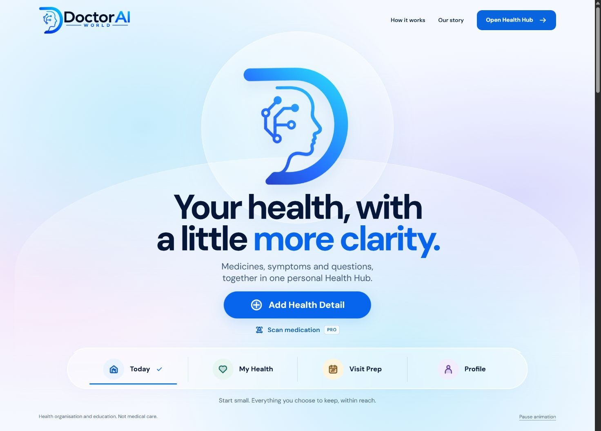
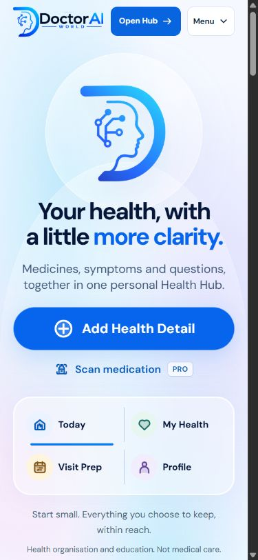
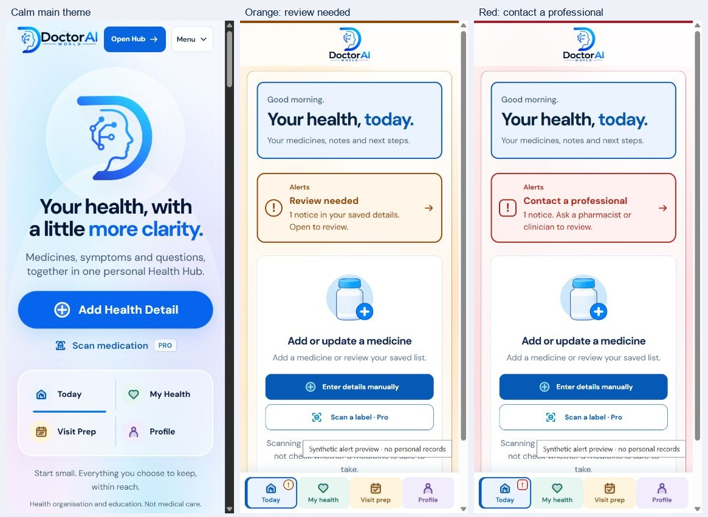
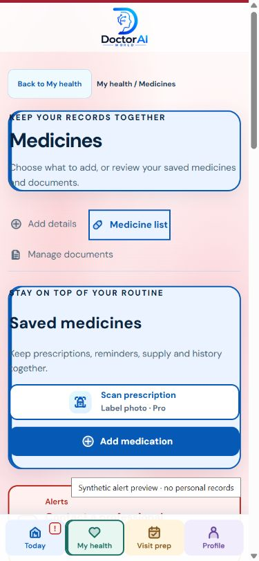

# Aurora screenshot walkthrough and demo narration

**Deliverable type:** screenshot walkthrough and timed narration/caption script; no video recording is claimed.

**Capture limits:** This subtask has no supported way to persist a fresh browser screenshot to the repository. The isolated in-app browser returned a zero-width capture, then timed out at `Page.captureScreenshot` after applying the requested 1487 × 1058 viewport. Visible IAB is unavailable in a subagent thread, and the user's Chrome preview belongs to another browser session. The existing local image files below are explicitly **pre-refresh** evidence; they are included as visual references, not represented as current captures. The exact reference attachment remains inline in the parent conversation and has no local export.

The parent captured the current desktop preview live at CSS viewport **1487 × 1058** (usable page area 1472 × 1058). The measured composition is close to the reference: current halo x506-982 vs reference ~495-982; heading y472 vs y473; primary CTA y714 vs y711; dock y858 vs y857. More saturated cyan/blue/lilac peripheral bokeh was added in the final refresh. That fresh screenshot could not be exported into this artifact. The current mobile homepage was visually inspected at 390 × 844, with no horizontal overflow, but its slices could not be persisted here. Existing responsive metrics report matching content/viewport widths at 320, 390, 680, 768, 1024, and 1487 CSS px; see [responsive.json](responsive.json).

## Visual references (pre-refresh)

These are the repository captures available for the walkthrough. Each predates the final palette/icon refresh per the accompanying design QA notes.

### Desktop hero and frosted dock

### Mobile hero and two-column dock

### Calm hero beside synthetic warning examples

### Medicine screen with a synthetic alert preview

## Three-minute walkthrough script

All story content is fictional. Do not enter or change any health details during this walkthrough. The alert examples in the referenced screenshots carry the banner “Synthetic alert preview — no personal records.”

| Time | Frame guidance | Narration | On-screen caption |
|---|---|---|---|
| 0:00–0:25 | Desktop hero reference. Hold on the halo, two-line heading, primary action, scan link, and dock. | “DoctorAI opens with a quieter place to begin. The soft cyan, lilac, and blush atmosphere frames the familiar blue mark, then leads with one clear promise: ‘Your health, with a little more clarity.’ Add Health Detail is the main action; medication label scanning stays a secondary Pro option.” | **A calm start. One clear next step.** |
| 0:25–0:50 | Mobile hero reference. Point out the full-width action and compact two-by-two dock. | “On a phone, the same hierarchy remains visible: the headline, supporting sentence, and Add Health Detail button come first. Today, My Health, Visit Prep, and Profile stay together in a compact dock, so the route names remain easy to find without crowding the screen.” | **Same hierarchy, compact mobile layout.** |
| 0:50–1:17 | Use the Add Health Detail action as a transition; no current chooser screenshot is available, so use a neutral title card until a fresh capture can be saved. | “For this fictional example, Alex wants to remember one question for an upcoming appointment. Tapping Add Health Detail opens the existing chooser: Medication, Health profile, Symptom, Appointment, Measurement, or Document or photo. Alex can choose only what is useful. This narration does not create or submit a record.” | **Fictional example · choose only what matters.** |
| 1:17–1:44 | Show pre-refresh [My Health desktop](../homepage-20261015/hub-theme-health-935.png) and [Profile mobile](../homepage-20261015/hub-theme-profile-390.png); label both as historical references. | “The Health Hub keeps its four destinations recognizable across the homepage and app. Category icons and shortcuts help with navigation; they do not signal health status. Profile remains the place for account and storage choices. A saved detail can stay in the browser or session according to the user’s selected storage preference.” | **Navigation colour is not a clinical status.** |
| 1:44–2:15 | Use the [synthetic orange and red columns](theme-states.jpg); make the synthetic banner legible. | “When a presentation example includes a notice, its severity keeps its clinical meaning. Orange says ‘Review needed.’ Red says ‘Contact a professional.’ Those messages remain distinct from the gentle page palette and category colours. A calm background is not an all-clear, and an alert is not a diagnosis.” | **Orange: review needed. Red: contact a professional.** |
| 2:15–2:43 | Show the pre-refresh [medicine screen](alert-red-mobile.jpg), then return to the [four-destination dock](desktop-stitched.jpg). | “Optional Pro scanning can help capture label details. It does not check drug interactions or determine whether a medicine is safe. The Hub is for organisation and education, not medical care. Any warning should keep its wording and non-colour indicator visible, even as the surrounding interface adopts the selected aurora theme.” | **Scanning captures label details; it does not assess safety.** |
| 2:43–3:00 | Return to the desktop hero reference and pause on the headline. | “The result is a softer first impression with familiar routes and clear actions. Alex decides what to keep and what to bring to a conversation with a care professional. No personal information was used in this walkthrough, and no recording of the live app was produced.” | **Your health, with a little more clarity.** |

## Verification boundary

- Desktop current layout measurements above were relayed from a fresh parent-task capture; the image is not stored here.
- The two saved homepage images and two warning images are pre-refresh repository captures. They must not be presented as current final screenshots.
- Current mobile and Add Health Detail chooser views were inspected live, but screenshots were not persisted in this document.
- No actual video, audio, or voice track was created. The companion [WebVTT captions](demo-captions-20261016.vtt) provide timed on-screen caption overlays; the full narration is in the table above, not in the VTT as a verbatim speech transcript.
- No health records, external service, scanner, camera, or personal account were used by this artifact.
