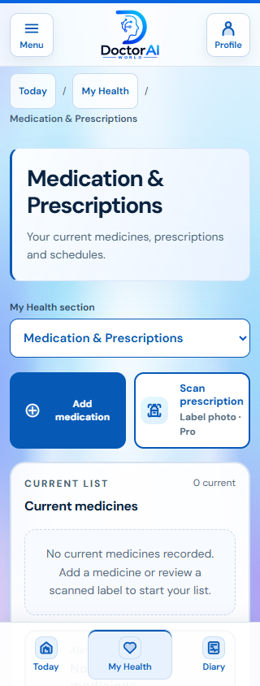
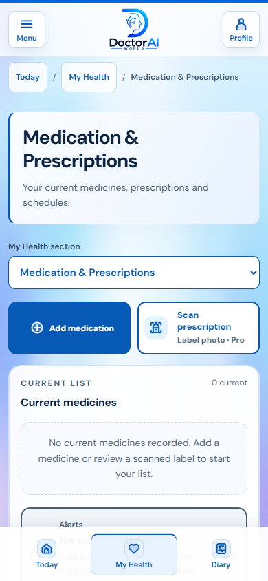
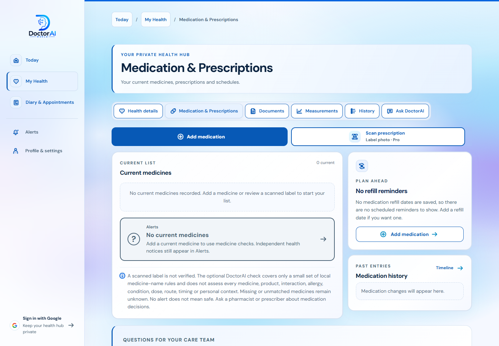

# Corrected My Health hierarchy and zero-medicine notices

This supersedes the initial PR80 navigation at `282444ca19b79fe17f6fff7a71af0eb4c0732b2c`. It remains a draft stacked on PR79/78. No production release is part of this work.

## Navigation

The primary destinations are **Today**, **My Health**, and **Diary & Appointments**. Alerts and Profile/settings remain separate utilities. Inside My Health, **Medication & Prescriptions** has Add and Scan actions directly above the full current medicine list. Scanning is a tool in this section. On phones, a labelled native section picker replaces the wide secondary tab row. The homepage uses the same hierarchy.

`#medications`, `#medicines`, `#prescriptions` and the old `#scan` all open My Health's medication section. `#scan` focuses its Scan action without automatically starting capture or sending an image. The original scan information/manual-entry controls remain in a disclosure within that section. Other old record and dialog links remain supported.

## Alert investigation: identified causes versus possibilities

We did not inspect Kam's real records or identify the exact notice he saw. The following are reproduced synthetic cases or direct code findings, not assumptions about his account.

| Case | Before correction | Correction / retained behavior |
| --- | --- | --- |
| Fresh, entirely empty state | Already neutral; zero actual notices | Still neutral. Clear “No current medicines” empty state; never green or labelled safe. |
| Allergy or condition saved, no medicines and no independent warning | Status became orange despite an empty notice array, because missing/unassessed coverage drove the colour | Neutral. Merely storing these details does not create a medicine warning. Coverage information remains available without an orange theme. |
| Only stopped, archived, future or ended medicine records | Health rule evaluation excluded these, but presentation used all supplied records as its medicine count and produced orange medicine-coverage wording | One shared lifecycle selector now drives rule inputs, current list, text checks, reminders and server-check payload. The status uses the active count. Excluded records remain available under “Other saved medicines (not current)”. |
| Direct medicine-engine request with zero medicines | General medicine coverage and condition-coverage notices were emitted even for an empty list | No medicine alerts. Coverage remains explicitly incomplete; an empty request is not a safety result. |
| Old saved server result with no current medicines | Local health engine already ignored it; a stale result was not reproduced as the cause of the global theme | Defensive controller handling now clears the result/time on an empty list, preserves only the current account's consent choice, cancels obsolete work and sends no empty check. Owner/signature/rules guards remain in force. |
| Independent recent breathing warning with recorded asthma and zero medicines | Supported urgent symptom/condition notices | Retained red/urgent. The banner identifies saved symptom entries; each notice shows the current supporting inputs. Independent conflicting health records still produce review notices. |

No clinical thresholds, ingredient mappings or retained clinical rules were added or relaxed. A recognised or unresolved active medicine still has limited/unknown coverage. A supported Marevan/Trisul pair remains red; deleting one leaves one limited active medicine, and deleting the last returns to neutral. No alert means neither safety nor clinical validation.

## Verification

- Passed [60 route/viewport cases](navigation-qa.json) at 320/390/1440px: nested active state, legacy links, section picker, heading focus, Back/Forward, reload, repeated selection, interrupted/cancelled dialogs, Privacy/summary bookmarks, menu Escape/Tab/resize and keyboard access to alerts.
- Passed [21 local browser lifecycle cases](zero-medication-browser.json): empty, allergy/condition only, stopped entries, a supported pair, unresolved identity, independent urgent symptom, old persisted check, add first medicine, delete last medicine and reload. Synthetic state only. The fixture seeds once, so reload tests verify saved deletion rather than reinstalling the original pair.
- Passed the shared lifecycle/empty-engine/controller tests in `verify-zero-medication-alerts.cjs`, including local date boundaries, no empty coverage alerts, stale zero-result removal, account isolation and preserved independent warnings.
- Passed automated axe WCAG 2/2.1 A/AA checks on [29 page/menu states](a11y.json), plus the [final current-medicine layout](final-medication-layout.json) at all three widths, with zero automated violations. Add/Scan precede the visible current list. This is not a full screen-reader or WCAG conformance audit.
- Passed JavaScript syntax, static site/assets/cache validation, navigation/account checks, device storage, health-state serializer/API contract, record preparation, medication database/safety/pipeline/controller/login/UI/evidence checks, the generated bundle check, 15 alert-status fixtures, 78 context fixtures and 12 presentation checks. Medication catalogue/seed data remains unchanged.
- Not run: real health accounts or data, live paid scanning/uploads, physical camera, real screen reader or production mutation. The fresh hosted browser is protected by Vercel authentication; local functional/visual checks remain the browser evidence.

The next authorised stage is a separate companion prototype containing My Next Steps, Help me say it and explicitly simulated Family Care. Those features are not implemented by this navigation/alert correction. The active turn cannot change its own model setting; this checkpoint is prepared for the requested SOL Ultra continuation.
