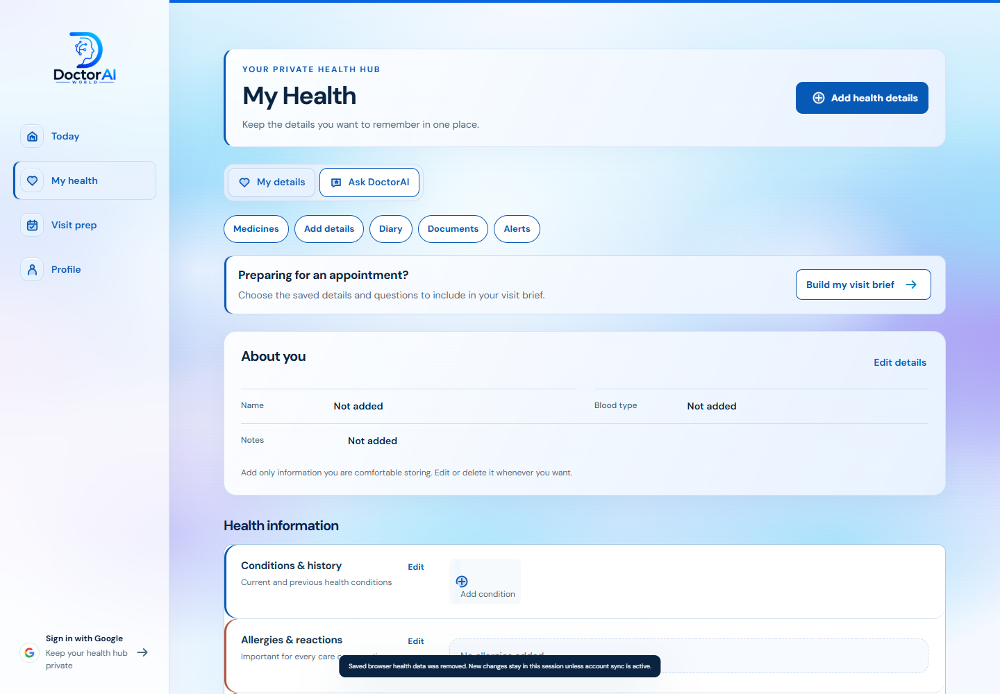
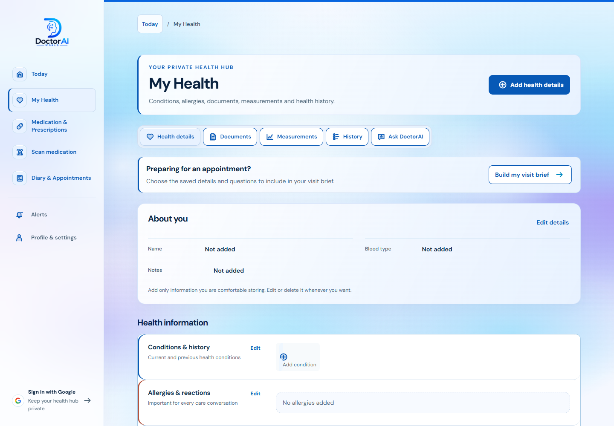
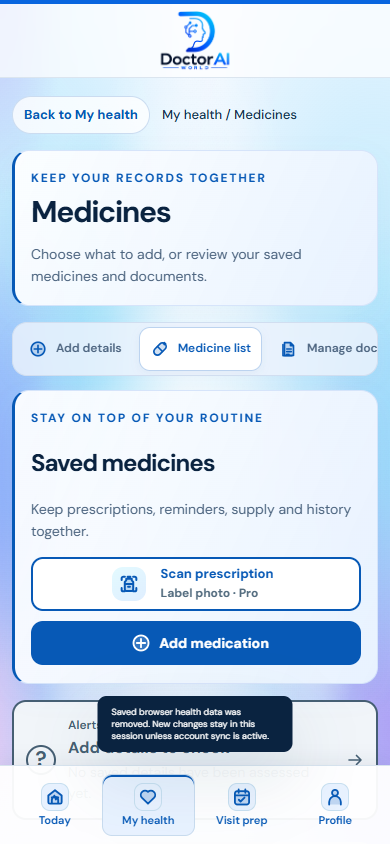
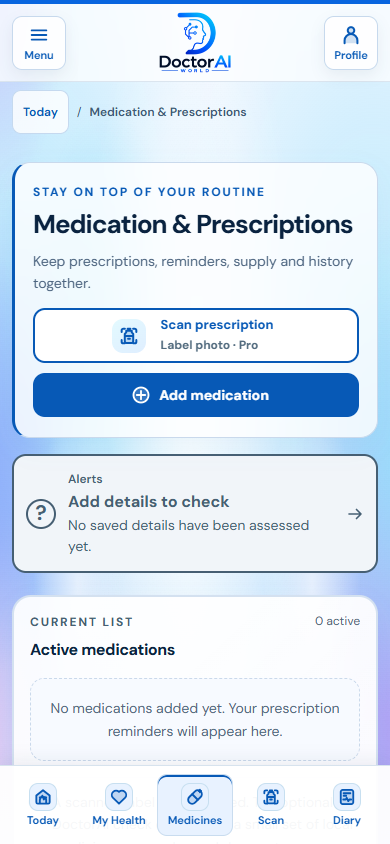
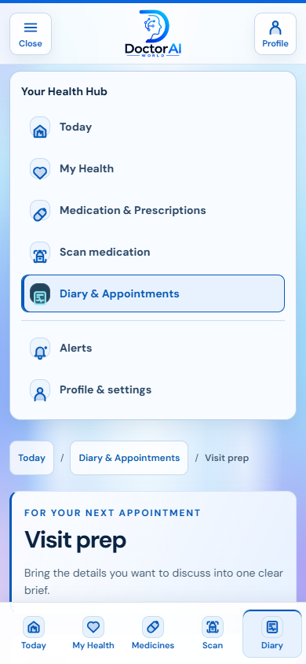
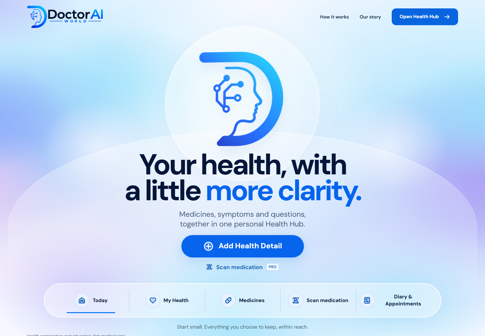

# Health Hub navigation clarity — 16 October 2026

This draft builds on PR [#79](https://github.com/kameronlewis1996-hash/doctoraiworld/pull/79), head `fbfc20b8b923ec4b496a50d63b63cdaeb9cc5e0c`, which includes the PR [#78](https://github.com/kameronlewis1996-hash/doctoraiworld/pull/78) Aurora alert theme. Main was inspected at `a130fc99a9866e6e779178675a09ab192642d619`. No production merge or deployment is part of this change.

## Navigation map

| Destination | What belongs here | Mobile label | Stable links |
| --- | --- | --- | --- |
| Today | Daily overview and direct task entry | Today | `#today` |
| My Health | Conditions, allergies, personal details, documents, measurements, health history and Ask DoctorAI | My Health | `#health`, `#documents`, `#results`, `#timeline`, `#ask` |
| Medication & Prescriptions | Medicine list, prescriptions, schedules, refill reminders, medication history and local check | Medicines | `#medications`; aliases `#medicines`, `#prescriptions` |
| Scan medication | Label/prescription capture, review and manual entry | Scan | `#scan` |
| Diary & Appointments | Observations, questions, appointments and visit preparation | Diary | `#diary`, `#symptoms`, `#appointments`, `#visit-prep` |
| Alerts, separate utility | Notices and coverage details | Full menu; Today badge and medicine shortcut retained | `#alerts` |
| Profile & settings, separate utility | Account, privacy, storage, personal shortcuts and optional Health Memory | Profile in header/full menu | `#profile`, `#memory`, `#privacy` |

`#add` retains the Add Health Detail chooser. `#summary` still opens the visit brief. `#visit` remains an alias for Visit prep. Unknown routes return to Today. The shared location trail returns to Today or the current task's parent section. Profile and Alerts have their own current-section state instead of pretending to be My Health.

## Captured audit and implementation

All screenshots were captured in this run in fresh browser contexts with empty/synthetic state, then opened and checked. The public main and the starting draft were inspected on desktop and phone. In-app browser automation was not callable in this executor; local Edge/Playwright rendered the actual checkout. Local API requests were stubbed as signed out/unconfigured, with no paid or clinical API calls.

1. **My Health, desktop — improved.** Before, its panel menu competed with a second row of five tools. After, one record menu groups Health details, Documents, Measurements, History and Ask. Medicines, Scan and Diary are direct sidebar destinations.

   
   

2. **Medication entry, phone — improved.** Before, My Health remained selected, medicine controls lived inside Add details, and a horizontal tab ran off screen. After, Medicines has its own selected tab, one primary heading, direct add/scan actions, and the existing alert shortcut immediately below.

   
   

3. **Full phone menu — working.** The previously hidden Menu control now exposes the same task order and separate Alerts/Profile links. Every target is at least 44 by 44 CSS pixels. Escape returns focus to Menu; selection closes it; moving focus outside closes the non-modal menu. Compact bottom labels have descriptive accessible names.

   

4. **Homepage entry — consistent.** The selected Aurora design now links to the same five destinations. The feature cards describe the four task areas, with Today, Alerts and Profile available as supporting links.

   

## Verification

- Passed: 60 route/viewport combinations at 1440, 390 and 320 CSS pixels, including old aliases; active panel, headings, no horizontal page overflow, heading focus, repeated taps without duplicate history, Back/Forward, reload, interrupted medication dialog, and Privacy/summary bookmark dialogs. A browser move that emits both `popstate` and `hashchange` is restored once so it cannot close a newly opened bookmark dialog.
- Passed: full-menu open/select/Escape/focus return on 390/320px; red alert banner remains reachable with Enter at every viewport. The original 158 Hub element IDs are all retained. Moving panels changes their grouping, not record state or forms.
- Passed: automated axe WCAG 2 A/AA and 2.1 A/AA checks on 27 page states plus two mobile menu states, with no violations in the final run; navigation target size and accessible-name checks. Corrected visible/spoken label mismatches in compact Medicines, health edit, alert summaries and Profile shortcuts.
- Passed: JavaScript syntax, static-site/assets/cache validation, navigation and account-isolation verifier, record preparation, device-storage, Today diary and open-catalogue checks. Medication database, local medication UI, evidence/provenance, generated alert bundle, 15 alert-status fixtures, 78 health-alert fixtures and 12 alert-presentation checks pass. Safety rules, medication data and the generated safety bundle have no diff against the pharmacy base.
- Evidence: [browser checks](navigation-qa.json), [automated accessibility checks](a11y.json). `scripts/verify-navigation-browser.cjs` can run against a local or preview URL with `NAVIGATION_BASE`; provide Playwright through `PLAYWRIGHT_MODULE` if it is not installed locally. `NAVIGATION_EVIDENCE_DIR` selects the output folder.
- Not run: assistive-technology testing with a real screen reader, physical phone/camera capture, real signed-in cloud sync, paid Scan/Pro calls, document upload or production mutation. Automated checks do not establish full WCAG compliance or clinical correctness.

The six displayed screenshots were also uploaded successfully to ChatGPT Library as image files. Local copies remain here with the report.
